<p align="center">
  
</p>

<h1 align="center">Unifire</h1>

<p align="center">
  <b>The missing control room for your UniFi network.</b><br>
  Scheduled egress routing, failover, quotas, rules, snapshots, device health, PoE schedules,<br>
  live topology and incident correlation. It is self-hosted and runs next to your UniFi OS gateway.
</p>

<p align="center">
  
  
  
  
  
  
  
</p>

<p align="center">
  <a href="#-features">Features</a> ·
  <a href="#-screenshots">Screenshots</a> ·
  <a href="#-quick-start">Quick start</a> ·
  <a href="docs/DEPLOY.md">Deployment</a> ·
  <a href="#-roadmap">Roadmap</a> ·
  <a href="README.zh-TW.md">繁體中文</a>
</p>

<picture>
  <source media="(prefers-color-scheme: light)" srcset="docs/assets/screenshots/dashboard-light.webp">
  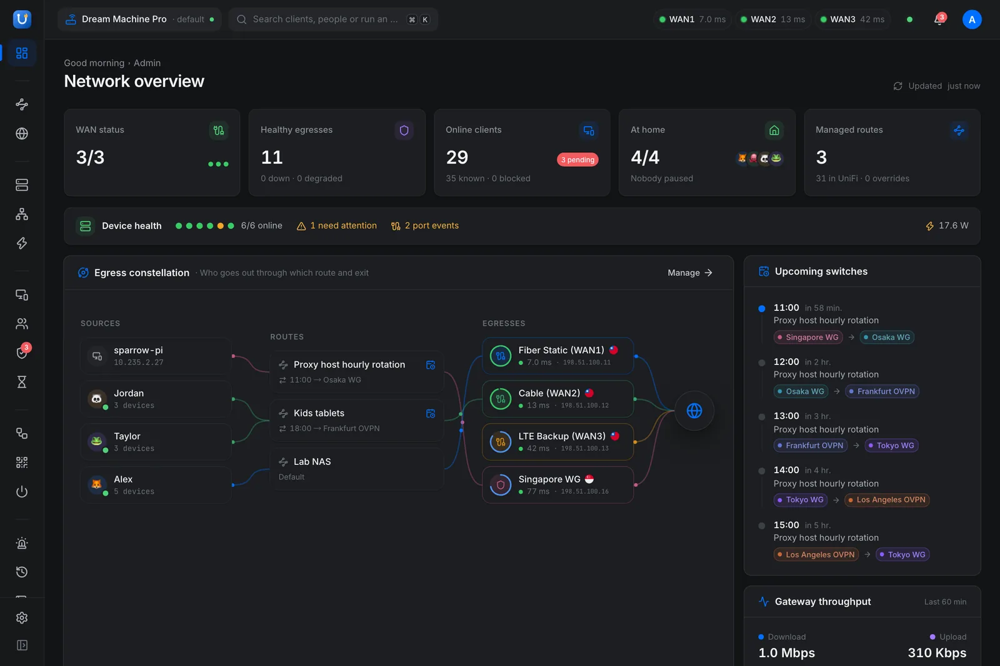
</picture>

> [!NOTE]
> Unifire is an independent community project. It is **not affiliated with, endorsed by or supported by Ubiquiti Inc.** UniFi is a trademark of Ubiquiti Inc.

## 🤔 Why Unifire?

UniFi is excellent at configuring a network, but it has gaps once you want the network to *behave*:

- A policy-based route always uses the same egress. You can't say "the proxy host uses WAN1 at midnight and rotates through VPNs the rest of the day".
- If a VPN client dies, routes that use it don't fail over by themselves.
- There are no per-person screen-time or data quotas, and no "pause the kids' devices at 22:00".
- History is short, and a single outage turns into a flood of unrelated alerts.
- Nothing tells you that a cable silently dropped from 1 Gbps to 100 Mbps.

Unifire adds all of this on top of your existing controller. It talks to the **same local API the UniFi web UI uses**, so it needs no firmware mods and installs nothing on the gateway. All of its state lives in its own SQLite database.

## ✨ Features

### 🧭 Routing & egress
- **Scheduled egress**: paint a 7×24 grid or generate a rotation (e.g. WAN1 at 00:00, then VPN A → B → C). Switches converge just before the hour and are read back to verify.
- **Health probes & automatic failover**: each WAN/VPN gets a dedicated probe route. Unifire fails over along a chain when probes fail and switches back with hysteresis.
- **One-tap temporary egress**: "use Tokyo for 2 hours" from ⌘K, a device drawer or a rule. It reverts to the schedule automatically.
- **Real exit-IP verification**: rotating sweeps record each egress's public IP, country and latency, and alert when the IP changes.

### 🛡️ Access control
- **New-device approval**: notify-only or strict (blocked until approved), with approve/block buttons in push and Telegram.
- **Time & data quotas** per person, group or device. Several devices online at once count as one person-minute.
- **Pause & bedtime** per person or group, plus "15 more minutes" allowances.
- **People, groups and a family portal**: members see their own quota rings and can request extensions.

### ⚙️ Automation
- **IF-THEN rule engine**: triggers, conditions and actions as visual blocks, with cooldowns, dry-run tests and run history.
- **PoE watchdog**: power-cycles a hung camera or IoT device on its switch port, with cooldowns and daily caps.
- **Guest Wi-Fi rotation** with a full-screen QR kiosk page, and **Wake-on-LAN** schedules.

### 🔭 Insight
- **Config snapshots** with semantic diffs ("route Kids: WAN1 → Tokyo WG") and per-item rollback. Each rollback is previewed as a dry-run first.
- **Change audit timeline** that separates Unifire's changes from external ones.
- **Long-term history & printable ISP reports**: uptime, p50/p95 latency, outages and speed tests.
- **Presence timeline** derived from phones, with a grace period for Wi-Fi sleep.

### 🖧 Infrastructure (switches & APs)
- **Device fleet & long-term health**: CPU, memory, temperature, uptime, firmware and 24 h availability. Unexpected reboots are told apart from restarts Unifire issued. Locate LED and remote restart are built in.
- **Port & cable guard**: a switch faceplate view that flags **speed downgrades**, error-rate spikes, link flapping and unknown devices plugged in. Every port has a history drawer.
- **PoE schedules & energy ledger**: turn PoE off by schedule (e.g. the kids' room AP at bedtime). Unifire only powers ports back on that it turned off itself. It shows per-port kWh and the money saved.
- **Live topology**: egress → gateway → switches → APs → people, with link speed, throughput and automatic bottleneck detection.
- **Room-level presence & roaming**: assign APs to rooms to see who is in which room. Each client's Wi-Fi roaming trail is recorded and sticky clients are detected.
- **Incident correlation**: related failures become *one* incident with a likely root cause ("Core Switch offline → 4 devices, 23 clients affected"). Config changes from the 15 minutes before the incident are linked to the snapshot diff.

### 📱 Everywhere
Installable **PWA** with offline shell and app badge. **Web Push, Telegram, Discord, ntfy and webhooks** carry actionable buttons. Sign-in works with passkeys, dark and light themes are included, and the full UI is available in **English and Traditional Chinese**.

## 📸 Screenshots

<table>
  <tr>
    <td width="50%">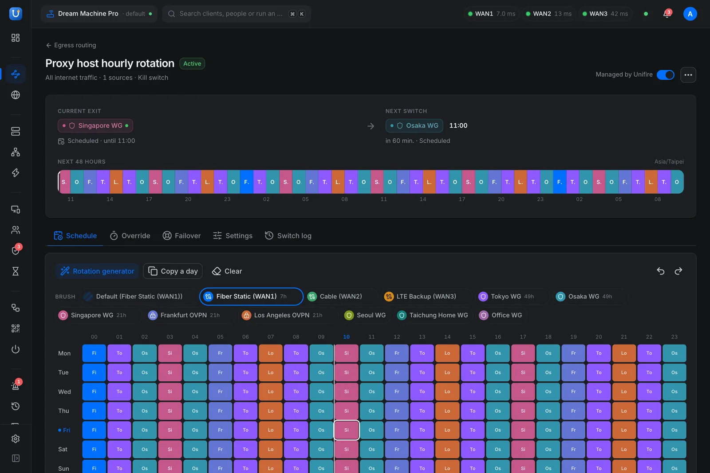<br><sub><b>Schedule editor</b>: paint a 7×24 egress grid and preview the next 48 h</sub></td>
    <td width="50%">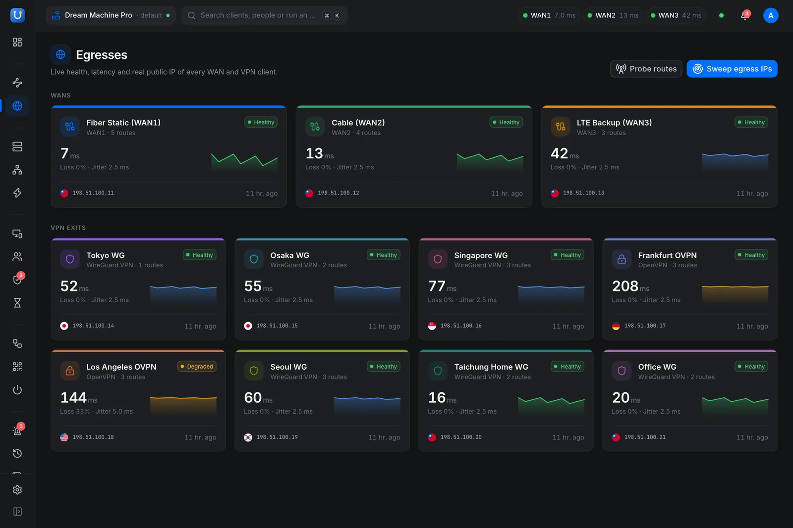<br><sub><b>Egresses</b>: latency, loss and real public IP of every WAN and VPN</sub></td>
  </tr>
  <tr>
    <td>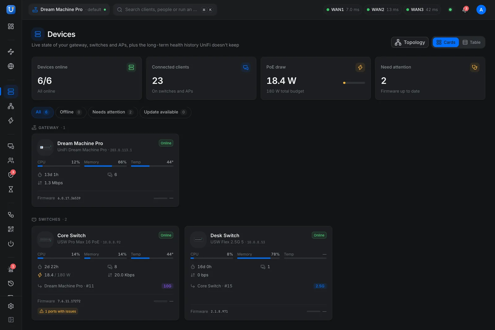<br><sub><b>Device fleet</b>: health, firmware and availability of the gateway, switches and APs</sub></td>
    <td>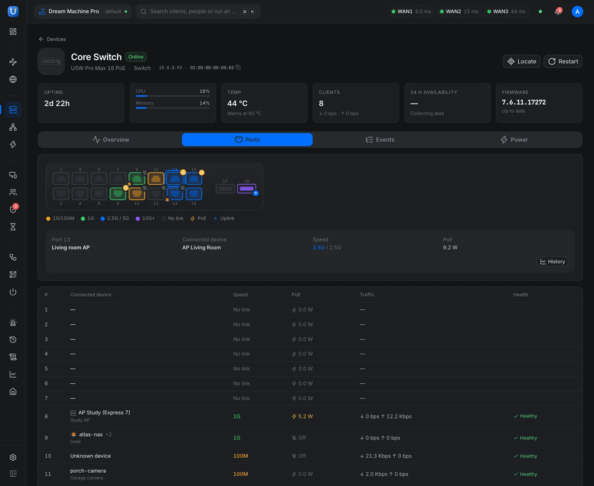<br><sub><b>Switch faceplate</b>: speed, PoE, peers and cable issues per port</sub></td>
  </tr>
  <tr>
    <td>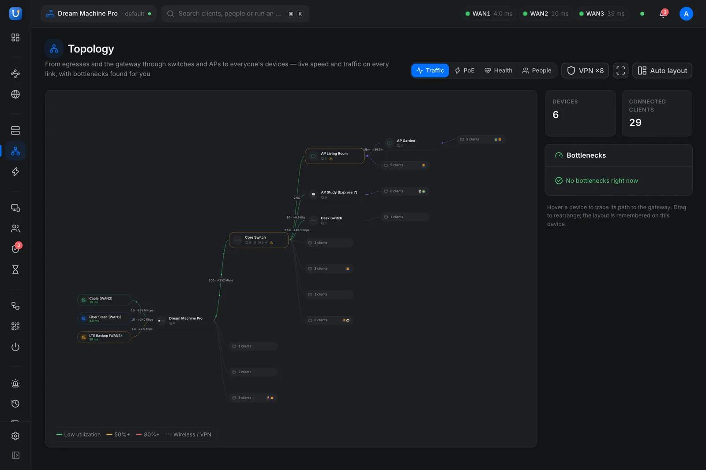<br><sub><b>Live topology</b> with link speeds, throughput and bottlenecks</sub></td>
    <td>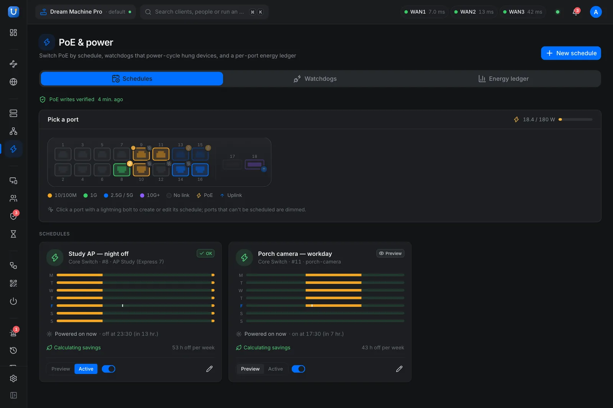<br><sub><b>PoE schedules</b> with safety checks and estimated savings</sub></td>
  </tr>
  <tr>
    <td>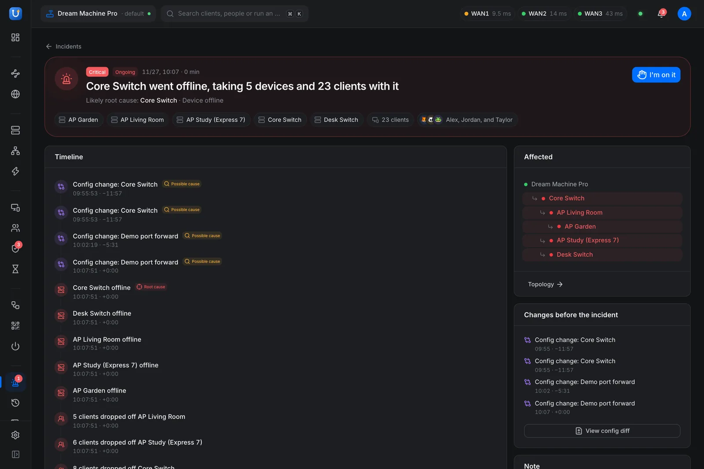<br><sub><b>Incident correlation</b>: root cause, impact and changes made just before</sub></td>
    <td>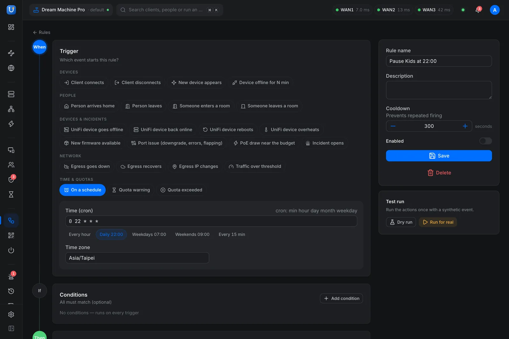<br><sub><b>Rule engine</b>: when → if → then blocks</sub></td>
  </tr>
  <tr>
    <td>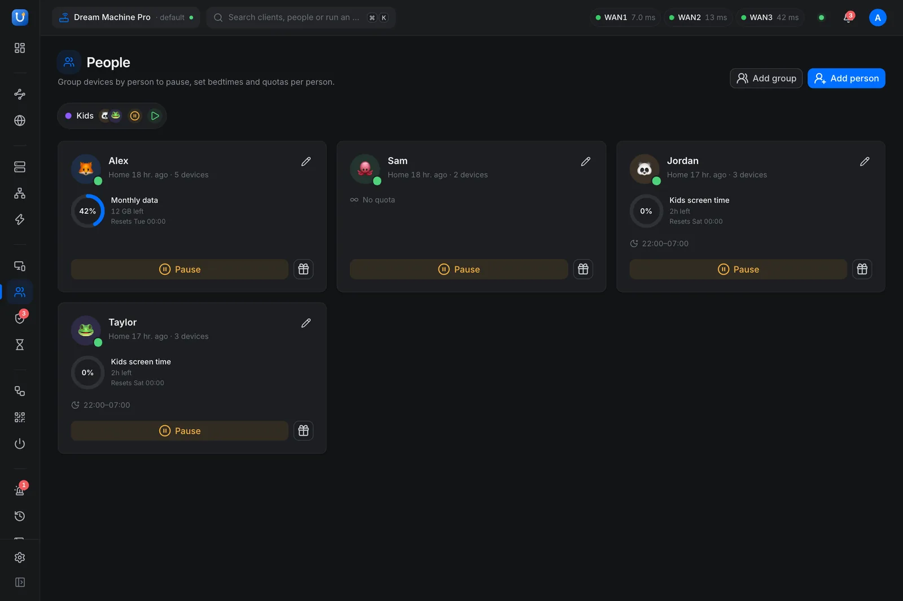<br><sub><b>People</b>: quota rings, pause and presence</sub></td>
    <td>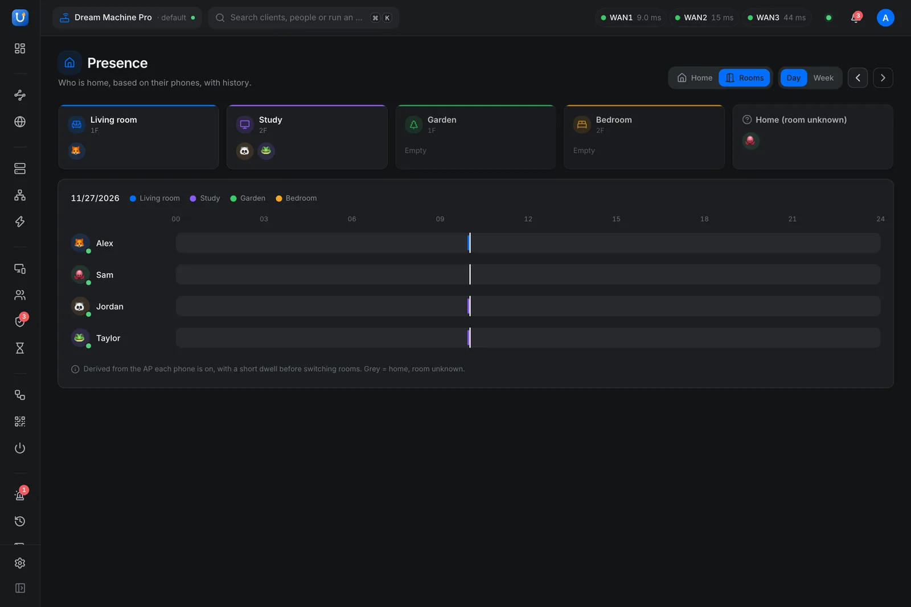<br><sub><b>Room-level presence</b>: who is in which room, over time</sub></td>
  </tr>
</table>

<p align="center">
  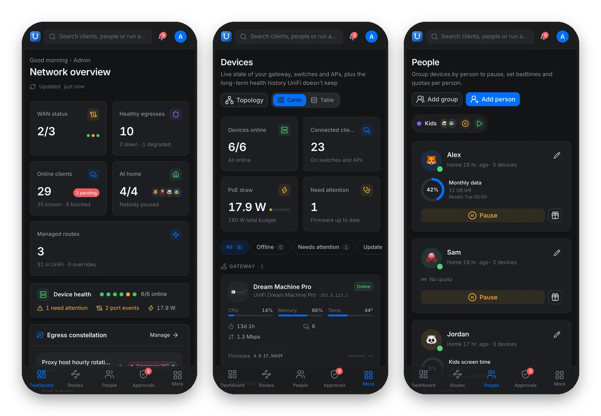<br>
  <sub>Mobile-first PWA: dashboard, devices and people</sub>
</p>

<sub>Screenshots show the built-in mock controller's demo data.</sub>

## 🚀 Quick start

### Try it in two minutes (no UniFi hardware needed)

Unifire ships with a built-in **mock controller** that simulates a gateway, switches, APs, VPN clients and roaming phones.

```sh
git clone https://github.com/lee98064/unifire.git && cd unifire
corepack enable && pnpm install
NUXT_MOCK_CONTROLLER=true NUXT_DATA_DIR=./.data-dev pnpm dev
```

Open <http://localhost:3000> and follow the first-run wizard. In mock mode an admin can stage events with `POST /api/dev/mock/:scenario`:
`reboot-ap`, `offline-switch`, `config-then-outage`, `recover`, `downgrade-port`, `port-errors`, `flap-port`, `new-device`, `roam`, `sticky`, `overheat` and `firmware-available`.

> [!TIP]
> If `pnpm dev` hits the file-watcher limit (`EMFILE`), run the production build instead:
> `pnpm build && NUXT_MOCK_CONTROLLER=true NUXT_DATA_DIR=./.data-dev NUXT_SESSION_COOKIE_SECURE=false node .output/server/index.mjs`

### Run it against your network (Docker Compose)

```sh
sudo install -d -m 0700 -o 1000 -g 1000 data
docker compose up -d --build
curl --fail http://127.0.0.1:3000/api/health
```

Then:
1. Put it behind HTTPS (an [Nginx example](deploy/nginx.conf.example) is included). PWA, push and passkeys need a secure origin.
2. Create a **dedicated local admin** in UniFi OS for Unifire.
3. Open Unifire and run the wizard: confirm the controller's certificate fingerprint, run the capability check and pick the egresses to probe.
4. Unifire starts in **dry-run**. Review what it would do in the audit log, then switch to live.

systemd, PM2, backups and upgrades are covered in **[docs/DEPLOY.md](docs/DEPLOY.md)**.

## 🔒 Safety first

Unifire writes to a production network, so it is conservative by design:

| Guard | What it does |
| --- | --- |
| **Dry-run by default** | A newly connected controller only *logs* intended writes until an admin switches to live. |
| **Single write gate** | Every write is serialized per site, snapshotted before, read back after and audited. |
| **Ownership** | Unifire writes only routes it created or that you explicitly adopted. Object-generated, predefined and excluded routes are read-only. PoE ports you turned off in UniFi are never turned on. |
| **Drift guard** | If someone changes a managed route or PoE port in the UniFi UI, Unifire pauses and notifies you instead of fighting the change. |
| **Write qualification** | A disabled scratch route (for routing) and an admin-chosen port (for PoE) must pass a write and read-back check before real writes are allowed. |
| **PoE safety rules** | Uplinks, ports with switches or mesh APs behind them, the Unifire host's own port and the path to the gateway can never be powered off. Powering off an AP needs explicit confirmation. |
| **Secrets** | Certificates are pinned TOFU-style. Credentials and snapshots are encrypted with AES-256-GCM, and `x_*` secrets are masked in the UI. |

## 🧱 How it works

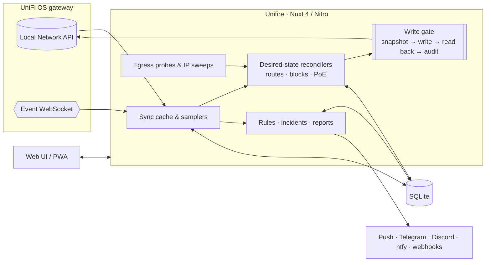

Unifire doesn't fire a one-shot cron at the top of the hour. It continuously computes **what should be true right now**, compares that with what UniFi reports and converges, both periodically and whenever an event arrives. This makes it idempotent, self-healing after restarts and able to detect drift. Routes, client blocks and PoE all follow this pattern.

| Layer | Stack |
| --- | --- |
| Frontend | Nuxt 4, Nuxt UI 4 (Reka UI + Tailwind v4), ECharts, Vue Flow, @nuxtjs/i18n, @vite-pwa/nuxt |
| Backend | Nitro (node-server), drizzle-orm + better-sqlite3, undici, ws, croner, web-push |
| Contract | `shared/api.ts` + zod schemas shared by UI and server |
| Tests | vitest with a fake UniFi controller, HTTP contract smoke tests, Playwright |

## ⚙️ Configuration

| Variable | Default | Purpose |
| --- | --- | --- |
| `PORT` / `NITRO_HOST` | `3000` / all interfaces | Listen port and address (use `127.0.0.1` behind a reverse proxy) |
| `NUXT_DATA_DIR` | `./.data` (`/data` in Docker) | SQLite database plus generated encryption and session keys |
| `NUXT_UNIFIRE_SECRET` | auto-generated `secret.key` | AES key for controller credentials and snapshots |
| `NUXT_SESSION_PASSWORD` | auto-generated `session.key` | Session cookie secret (≥ 32 chars) |
| `NUXT_TRUST_PROXY` | `false` | Trust `X-Forwarded-*` from your reverse proxy |
| `NUXT_LOG_LEVEL` | `info` | `silent` · `error` · `warn` · `info` · `debug` |
| `NUXT_MOCK_CONTROLLER` | `false` | Use the bundled fake controller (development only) |

> [!IMPORTANT]
> Back up the data directory **including its key files**. Without the encryption key, saved credentials and snapshots can't be restored.

## 🗺️ Roadmap

- [x] Scheduled egress, failover, temporary egress, exit-IP verification
- [x] Approvals, quotas, pause/bedtime, people & family portal
- [x] Rule engine, PoE watchdog, guest Wi-Fi rotation, Wake-on-LAN
- [x] Snapshots & rollback, audit timeline, ISP reports, presence
- [x] Device fleet health, port & cable guard, PoE schedules & energy ledger
- [x] Live topology, room presence & roaming, incident correlation, availability report
- [ ] Staged firmware rollouts with health gates (one device at a time, presence-aware maintenance windows)
- [ ] Home Assistant MQTT discovery bridge (presence, rooms, egress health, PoE switches)
- [ ] Multiple consoles and sites
- [ ] Optional support for the official UniFi Integration API (API keys)

## 🛠️ Development

```sh
pnpm typecheck       # nuxt typecheck (vue-tsc)
pnpm test            # vitest against a fake UniFi controller, never real hardware
pnpm build           # production build (also catches template errors vue-tsc misses)
pnpm test:contract http://127.0.0.1:3000   # HTTP contract smoke test against a running server
```

```
app/          pages, components, composables, design tokens
shared/       API contract (shared/api.ts) and zod schemas used by UI and server
server/
  api/        REST handlers validated against shared/schemas
  unifi/      UniFi client, write gate, capability probe, mock controller
  engine/     reconcilers, probes, rules, notifiers, snapshots, infra (devices, ports, PoE, topology, rooms, incidents)
  db/         drizzle schema with inline migrations (applied at boot)
i18n/         en.json, zh-TW.json
tests/        unit & integration tests, de-identified real-controller fixtures
deploy/       systemd unit, Nginx example
docs/         plans, deployment guide, UniFi API research, captured wire shapes
```

- User-facing server strings are i18n keys, registered in [`docs/backend/i18n-keys.md`](docs/backend/i18n-keys.md).
- [`scripts/capture-wire.ts`](docs/backend/capture-wire.md) captures **read-only, de-identified** UniFi payloads from a real controller to keep fixtures and the mock honest.

## 📚 Documentation

| Document | Contents |
| --- | --- |
| [docs/DEPLOY.md](docs/DEPLOY.md) | Docker, systemd, PM2, HTTPS, first run, dry-run → live, backup & upgrade |
| [docs/unifi-api-research.md](docs/unifi-api-research.md) | UniFi API research: endpoints, payloads, pitfalls |
| [docs/unifi-wire-shapes-infra.md](docs/unifi-wire-shapes-infra.md) | Real (de-identified) device, port and radio payloads from Network 11 |
| [docs/PLAN.md](docs/PLAN.md) · [docs/PLAN-infra.md](docs/PLAN-infra.md) | Design documents (Traditional Chinese) |

## ⚠️ Known limitations

- Unifire uses UniFi's **internal** API, so fields can change between Network releases. Re-run the capability check after upgrading UniFi Network.
- One controller and one site per Unifire instance (for now).
- Routing writes were validated on a UDM Pro (UniFi OS 6.0.17, Network 11.0.104). PoE writes must pass a qualification check on every Network version.
- Network 11 doesn't publish roam events over its WebSocket, so roaming is inferred from client sync messages and polling.

## 🙏 Acknowledgements

Unifire's UniFi integration builds on what the community has documented, especially
[Art-of-WiFi/UniFi-API-client](https://github.com/Art-of-WiFi/UniFi-API-client),
[Kane610/aiounifi](https://github.com/Kane610/aiounifi) (Home Assistant),
[unpoller/unpoller](https://github.com/unpoller/unpoller) and the many people who shared captures and findings on the UniFi community forums.

## 📄 License

No license has been chosen yet, so all rights are reserved for now. Please open an issue if you'd like to use or contribute.
