<p align="center">
  
</p>

<h1 align="center">Unifire</h1>

<p align="center">
  <b>補齊 UniFi 缺少的那間「網路控制室」。</b><br>
  排程出口、自動備援、上網配額、規則引擎、設定快照、設備健康、PoE 排程、<br>
  即時拓撲與事故關聯。自架在你的 UniFi OS 閘道旁邊。
</p>

<p align="center">
  
  
  
  
  
  
  
</p>

<p align="center">
  <a href="#-功能">功能</a> ·
  <a href="#-截圖">截圖</a> ·
  <a href="#-快速開始">快速開始</a> ·
  <a href="docs/DEPLOY.md">部署</a> ·
  <a href="#-roadmap">Roadmap</a> ·
  <a href="README.md">English</a>
</p>

<picture>
  <source media="(prefers-color-scheme: light)" srcset="docs/assets/screenshots/dashboard-light.webp">
  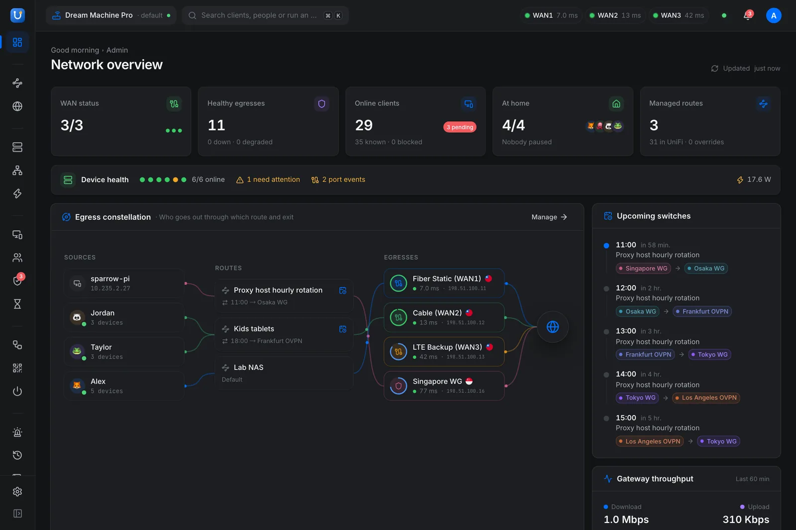
</picture>

> [!NOTE]
> Unifire 是獨立的社群專案，與 Ubiquiti Inc. **沒有任何關係，也未獲其背書或支援**。UniFi 是 Ubiquiti Inc. 的商標。

## 🤔 為什麼需要 Unifire？

UniFi 很擅長「設定」網路，但想讓網路依情境自己「行動」時，就會碰到不少缺口：

- Policy-Based Route 永遠只走同一個出口。沒辦法設定「代理主機午夜走 WAN1，其他時段輪流走幾條 VPN」。
- VPN Client 掛了，走它的路由不會自己切到備援。
- 沒有以「人」為單位的上網時數或流量配額，也沒有「晚上 10 點暫停小孩的裝置」。
- 歷史資料保留很短，一次斷線就會冒出一堆看不出關聯的警報。
- 網路線從 1 Gbps 默默掉到 100 Mbps 時，沒有任何東西會提醒你。

Unifire 架在現有控制器之上，補齊這些功能。它使用 **UniFi 網頁介面本身用的本機 API**，不需要改韌體，也不用在閘道上安裝任何東西。所有狀態都存在 Unifire 自己的 SQLite。

## ✨ 功能

### 🧭 路由與出口
- **排程出口**：直接在 7×24 格子上塗色，或用輪替產生器（例如 00 點走 WAN1，其他時段 VPN A → B → C）。整點前預先收斂，寫入後讀回驗證。
- **健康探測與自動備援**：每個 WAN／VPN 都有專屬探測路由，探測失敗時依備援鏈切換，恢復時有遲滯，避免來回跳。
- **一鍵臨時出口**：例如「改走 Tokyo 兩小時」，可以從 ⌘K、裝置抽屜或規則觸發，時間到自動回到排程。
- **實際出口 IP 驗證**：輪流掃描每個出口的公網 IP、國家與延遲，IP 變化時通知。

### 🛡️ 存取管控
- **新裝置審核**：模式分「僅通知」和「嚴格」（核准前先封鎖），可以直接在推播或 Telegram 上核准或封鎖。
- **上網時數與流量配額**：可以依人、群組或裝置設定。同一人多台裝置同時上網只算一次。
- **暫停與睡覺時段**：以人或群組為單位，也能臨時「再給 15 分鐘」。
- **人員、群組與家人入口**：家人可以看到自己的配額圓環，並申請延長。

### ⚙️ 自動化
- **IF-THEN 規則引擎**：用視覺積木組合觸發、條件與動作，有冷卻時間、試跑和執行紀錄。
- **PoE 看門狗**：攝影機或 IoT 裝置當機時，自動斷電重啟它所在的交換器 port，並有冷卻時間和每日上限。
- **訪客 Wi-Fi 密碼輪換**，附全螢幕 QR Code kiosk 頁；另有 **Wake-on-LAN** 排程。

### 🔭 維運洞察
- **設定快照**：語意化差異比對（例如「路由 Kids：WAN1 → Tokyo WG」），可以逐項回滾，回滾前會先以 dry-run 預覽。
- **變更稽核時間軸**：分辨每筆變更是 Unifire 做的還是外部做的。
- **長期歷史與可列印的 ISP 月報**：可用率、p50／p95 延遲、斷線紀錄、測速走勢。
- **在家狀態時間軸**：依手機連線判斷，有寬限期，避免手機 Wi-Fi 休眠造成誤判。

### 🖧 設備維運（交換器與 AP）
- **設備總覽與長期健康**：CPU、記憶體、溫度、uptime、韌體、24 小時可用率。分辨非預期重開機與 Unifire 自己發起的重啟，支援閃燈定位和遠端重啟。
- **線材與埠健康守衛**：仿實機的交換器面板圖，偵測**降速**、錯誤率暴增、反覆斷線和接上陌生裝置，每個 port 都有歷史抽屜。
- **PoE 排程與電力帳本**：依時段關閉 PoE（例如小孩房的 AP 在睡覺時間斷電）。Unifire 只恢復自己關掉的 port，並顯示每個 port 的用電度數和省下的電費。
- **即時拓撲**：出口 → 閘道 → 交換器 → AP → 每個人，標示每條線的速率與流量，並自動找出瓶頸。
- **房間級在家與漫遊軌跡**：把 AP 指派到房間，就能看到誰在哪個房間；同時記錄每台裝置的 Wi-Fi 漫遊軌跡，並偵測黏滯裝置。
- **事故關聯**：把相關的異常合併成**一起**事故，推測根因（例如「Core Switch 離線 → 4 台設備、23 台裝置受影響」），並把事故前 15 分鐘內的設定變更連到快照差異。

### 📱 隨處可用
可安裝的 **PWA**，有離線畫面和 App 徽章。**Web Push、Telegram、Discord、ntfy、Webhook** 通知都附帶操作按鈕。支援 Passkey 登入、深色與淺色主題，整個介面都有**英文與繁體中文**。

## 📸 截圖

<table>
  <tr>
    <td width="50%">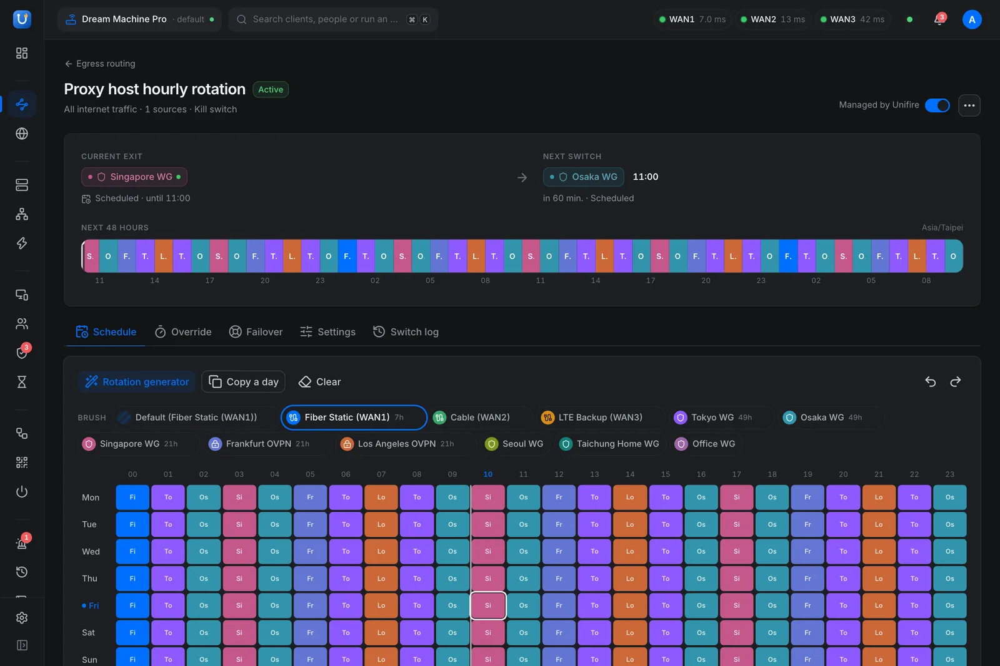<br><sub><b>排程編輯器</b>：在 7×24 格子上塗色，並預覽未來 48 小時</sub></td>
    <td width="50%">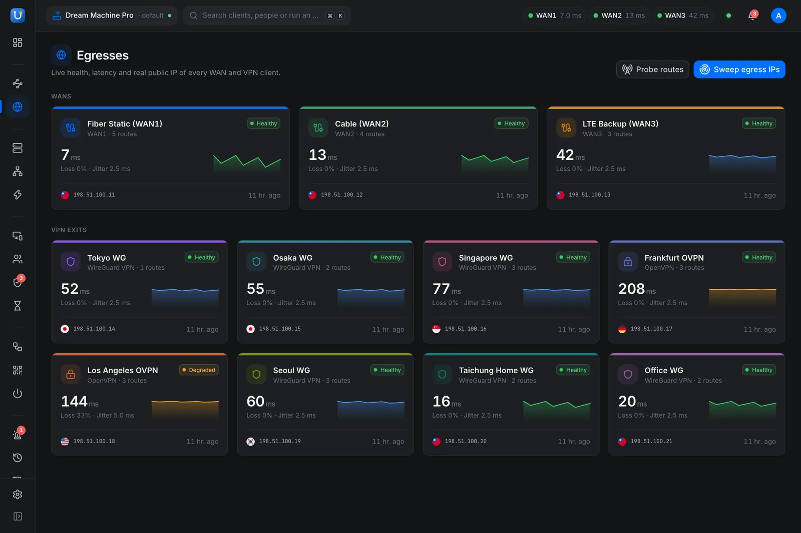<br><sub><b>出口</b>：每條 WAN 與 VPN 的延遲、丟包和實際公網 IP</sub></td>
  </tr>
  <tr>
    <td>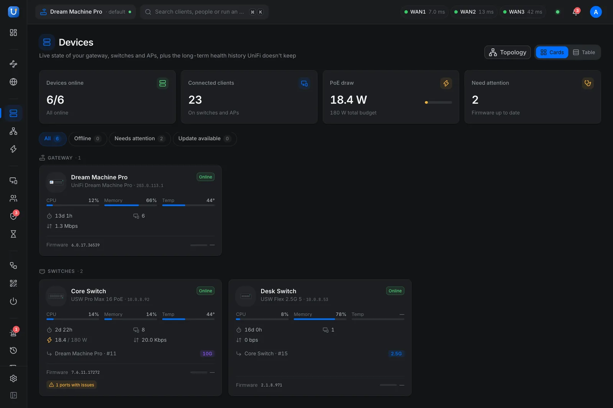<br><sub><b>設備總覽</b>：閘道、交換器與 AP 的健康、韌體和可用率</sub></td>
    <td>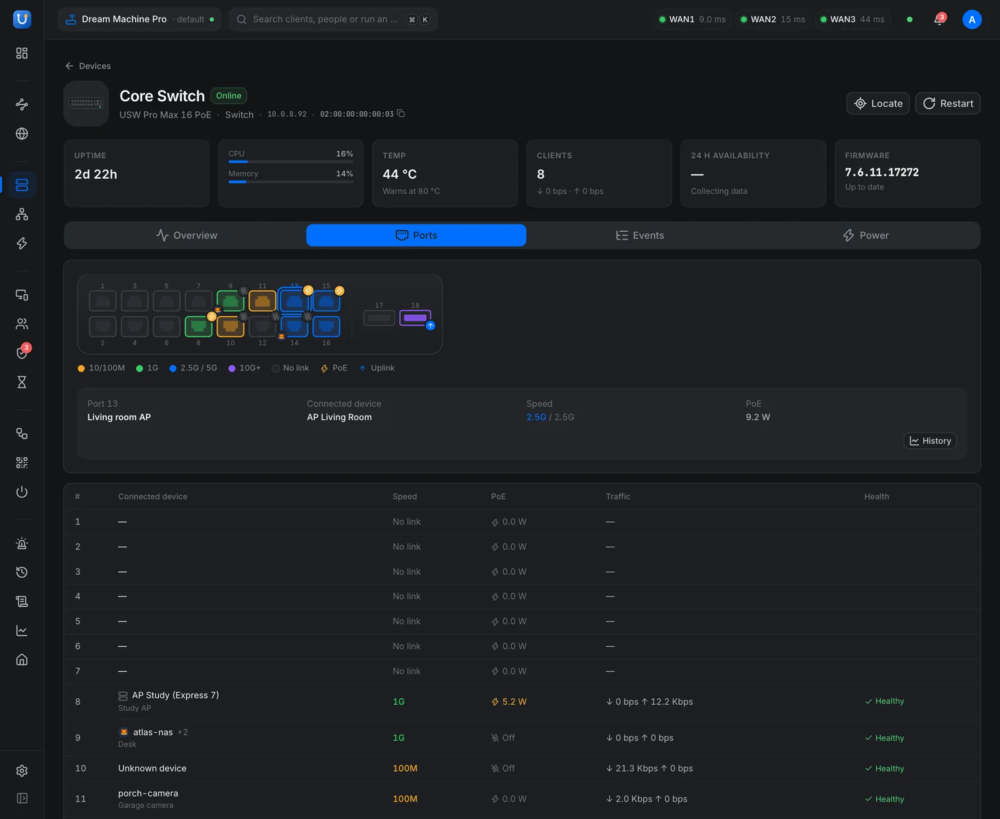<br><sub><b>交換器面板</b>：每個 port 的速率、PoE、接了什麼、線材問題</sub></td>
  </tr>
  <tr>
    <td>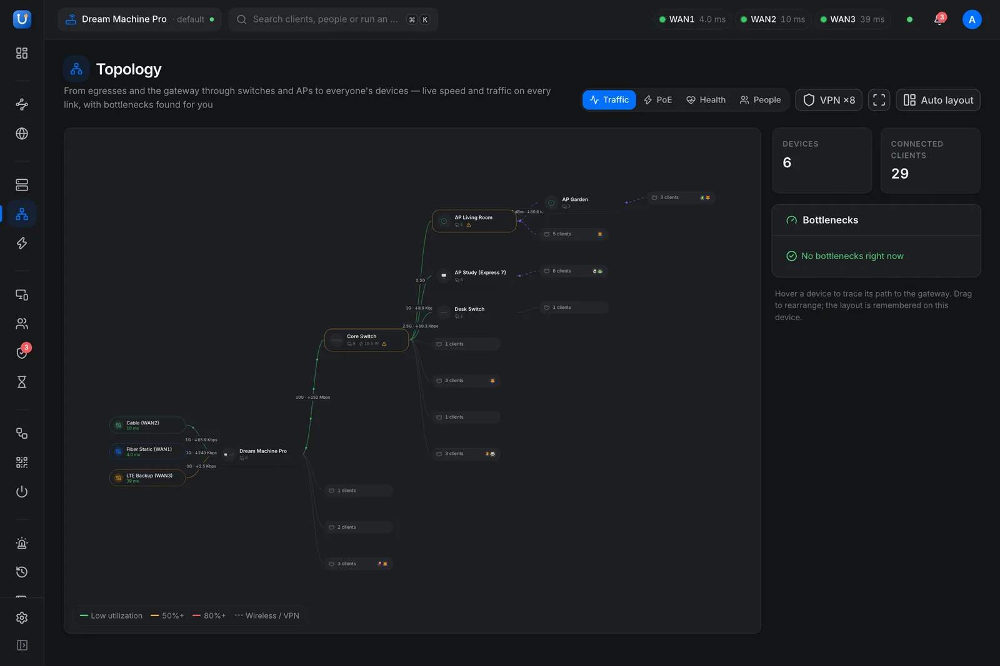<br><sub><b>即時拓撲</b>：速率、流量與瓶頸一目了然</sub></td>
    <td>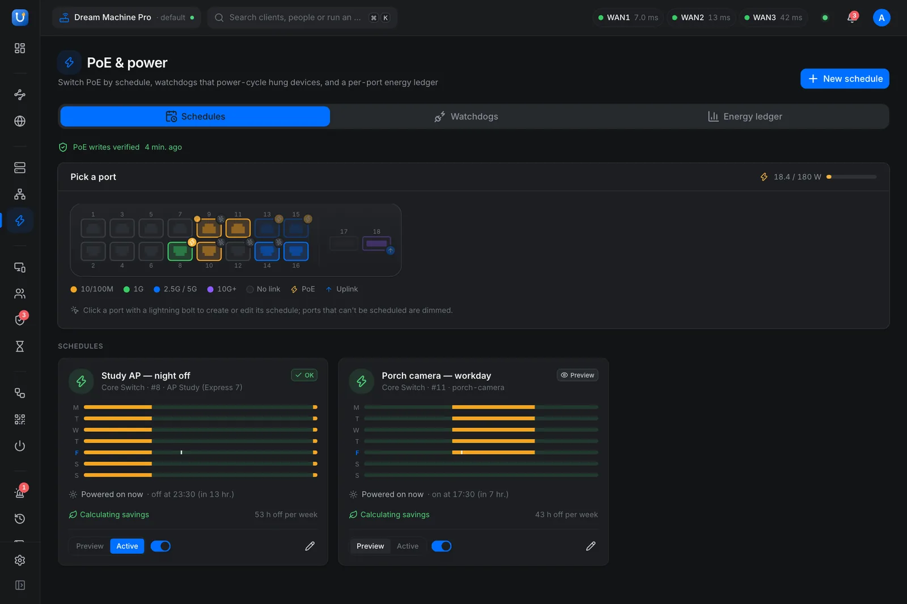<br><sub><b>PoE 排程</b>：附安全檢查與省電估算</sub></td>
  </tr>
  <tr>
    <td>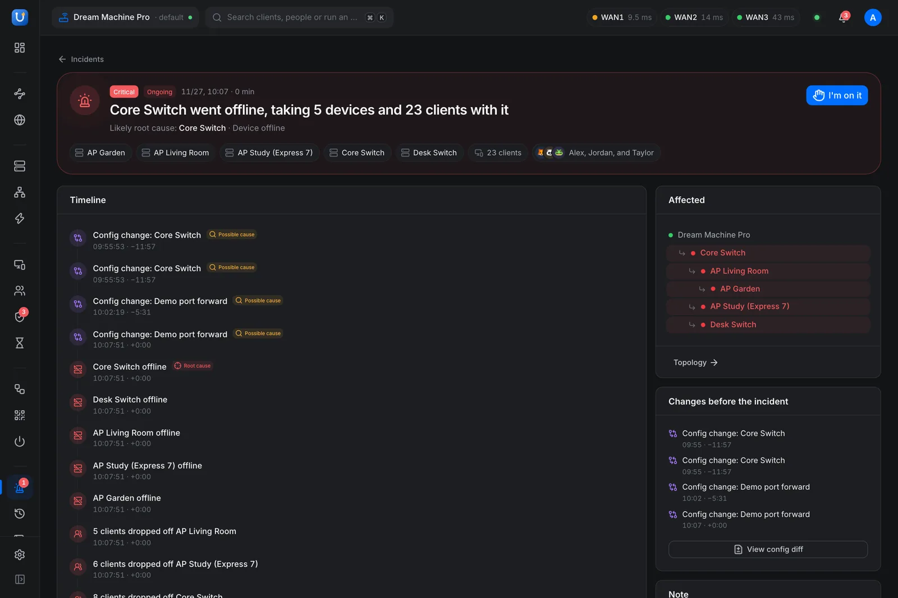<br><sub><b>事故關聯</b>：根因、影響範圍、事故前的變更</sub></td>
    <td>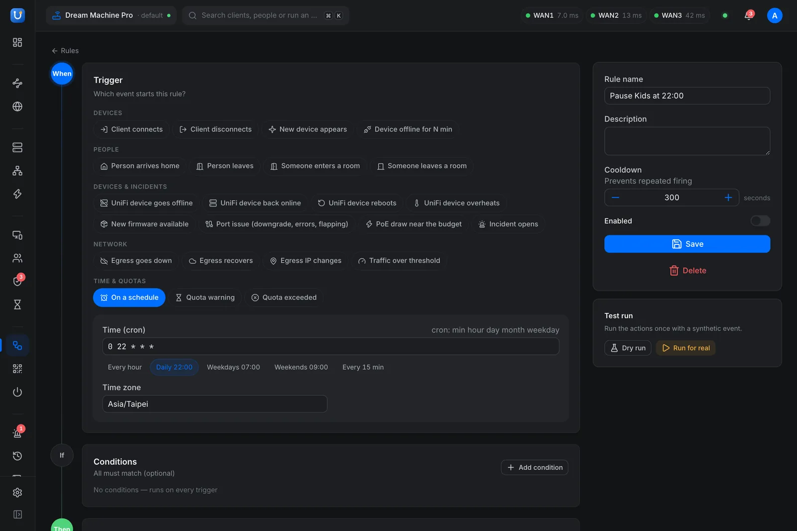<br><sub><b>規則引擎</b>：當…／如果…／就…積木</sub></td>
  </tr>
  <tr>
    <td>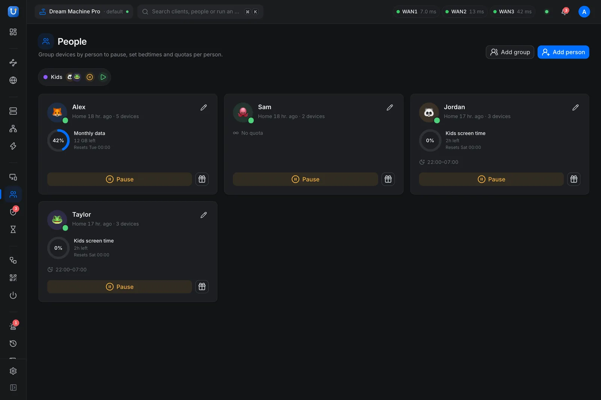<br><sub><b>人員</b>：配額圓環、暫停上網與在家狀態</sub></td>
    <td>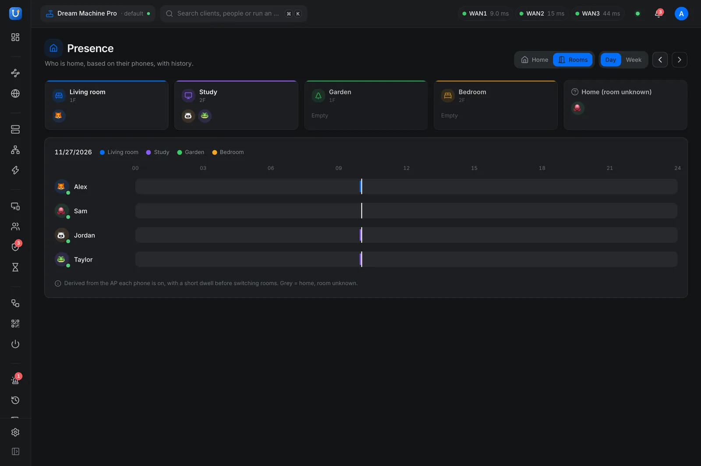<br><sub><b>房間級在家</b>：誰在哪個房間，隨時間變化</sub></td>
  </tr>
</table>

<p align="center">
  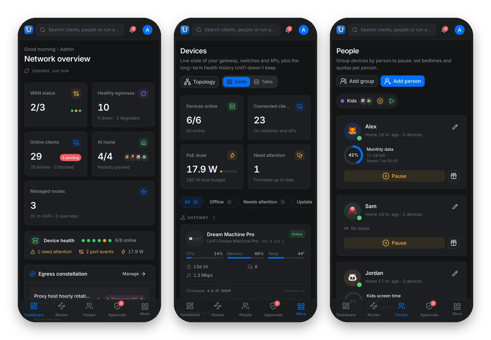<br>
  <sub>手機優先的 PWA：總覽、設備與人員</sub>
</p>

<sub>截圖使用內建 mock 控制器的示範資料，介面語言為英文。</sub>

## 🚀 快速開始

### 兩分鐘試玩（不需要 UniFi 設備）

Unifire 內建 **mock 控制器**，模擬閘道、交換器、AP、VPN Client 和會漫遊的手機。

```sh
git clone https://github.com/lee98064/unifire.git && cd unifire
corepack enable && pnpm install
NUXT_MOCK_CONTROLLER=true NUXT_DATA_DIR=./.data-dev pnpm dev
```

打開 <http://localhost:3000>，依首次啟動精靈建立管理員即可。在 mock 模式下，管理員可以呼叫 `POST /api/dev/mock/:scenario` 製造情境：
`reboot-ap`、`offline-switch`、`config-then-outage`、`recover`、`downgrade-port`、`port-errors`、`flap-port`、`new-device`、`roam`、`sticky`、`overheat`、`firmware-available`。

> [!TIP]
> 如果 `pnpm dev` 遇到檔案監看上限（`EMFILE`），改用正式建置：
> `pnpm build && NUXT_MOCK_CONTROLLER=true NUXT_DATA_DIR=./.data-dev NUXT_SESSION_COOKIE_SECURE=false node .output/server/index.mjs`

### 接上你的網路（Docker Compose）

```sh
sudo install -d -m 0700 -o 1000 -g 1000 data
docker compose up -d --build
curl --fail http://127.0.0.1:3000/api/health
```

接著：
1. 放到 HTTPS 後面（附 [Nginx 範例](deploy/nginx.conf.example)）。PWA、推播和 Passkey 都需要安全環境。
2. 在 UniFi OS 為 Unifire 建立**專用的本機管理員**。
3. 打開 Unifire 跑一次精靈：確認控制器憑證指紋、執行能力檢測、選擇要探測的出口。
4. Unifire 一開始是 **Dry-run**。先在稽核紀錄確認它「打算做什麼」，沒問題再切到寫入模式。

systemd、PM2、備份與升級請見 **[docs/DEPLOY.md](docs/DEPLOY.md)**。

## 🔒 安全設計

Unifire 會寫入正式網路，所以設計上刻意保守：

| 防護 | 做法 |
| --- | --- |
| **預設 Dry-run** | 新連線的控制器只會「記錄」打算做的寫入，要由管理員手動切到寫入模式。 |
| **單一寫入閘道** | 所有寫入都依站點序列化，寫入前拍快照、寫入後讀回驗證，並留下稽核紀錄。 |
| **擁有權** | 只寫入 Unifire 建立或你明確認領的路由。Object 產生的路由、預設路由和排除清單一律唯讀。你在 UniFi 中關掉的 PoE port 永遠不會被打開。 |
| **漂移守衛** | 有人在 UniFi 介面改了受管的路由或 PoE port 時，Unifire 會暫停管理並通知你，不會跟你搶。 |
| **寫入資格驗證** | 路由用一條停用的測試路由驗證，PoE 由管理員挑一個 port 驗證，寫入並讀回通過後才允許真正寫入。 |
| **PoE 安全規則** | 上連埠、後面接著交換器或 Mesh AP 的 port、Unifire 主機所在的 port、通往閘道路徑上的 port，一律不准斷電。關閉 AP 的供電需要明確確認。 |
| **機密保護** | 控制器憑證採 TOFU 釘選；帳密與快照以 AES-256-GCM 加密；介面上會遮蔽 `x_*` 機密欄位。 |

## 🧱 運作方式

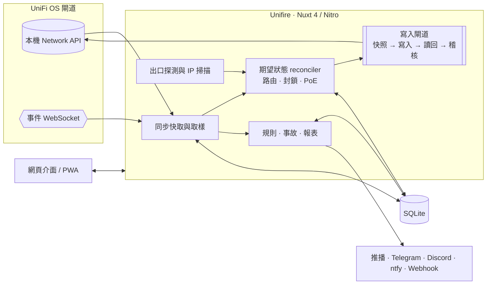

Unifire 不是「整點觸發一次」的 cron。它會週期性地，以及每當事件發生時，持續計算「**此刻應該是什麼狀態**」，再跟 UniFi 回報的實際狀態比對收斂。因此它具冪等性、重開機後能自動補齊，也能偵測漂移。路由、裝置封鎖和 PoE 都用這套模式。

| 層 | 技術 |
| --- | --- |
| 前端 | Nuxt 4、Nuxt UI 4（Reka UI + Tailwind v4）、ECharts、Vue Flow、@nuxtjs/i18n、@vite-pwa/nuxt |
| 後端 | Nitro（node-server）、drizzle-orm + better-sqlite3、undici、ws、croner、web-push |
| 契約 | `shared/api.ts` 與 zod schema，前後端共用 |
| 測試 | vitest（搭配 fake UniFi 控制器）、HTTP 契約煙霧測試、Playwright |

## ⚙️ 設定

| 變數 | 預設 | 用途 |
| --- | --- | --- |
| `PORT` / `NITRO_HOST` | `3000` / 所有介面 | 監聽的連接埠與位址（放在反向代理後時建議 `127.0.0.1`） |
| `NUXT_DATA_DIR` | `./.data`（Docker 為 `/data`） | SQLite 資料庫，以及自動產生的加密與 session 金鑰 |
| `NUXT_UNIFIRE_SECRET` | 自動產生 `secret.key` | 加密控制器帳密與快照的 AES 金鑰 |
| `NUXT_SESSION_PASSWORD` | 自動產生 `session.key` | Session cookie 金鑰（至少 32 字元） |
| `NUXT_TRUST_PROXY` | `false` | 信任反向代理傳來的 `X-Forwarded-*` |
| `NUXT_LOG_LEVEL` | `info` | `silent` · `error` · `warn` · `info` · `debug` |
| `NUXT_MOCK_CONTROLLER` | `false` | 使用內建 fake 控制器（只限開發） |

> [!IMPORTANT]
> 備份時請**連同資料目錄裡的金鑰檔**一起保存。少了加密金鑰，就無法還原已儲存的帳密與快照。

## 🗺️ Roadmap

- [x] 排程出口、自動備援、臨時出口、實際出口 IP 驗證
- [x] 新裝置審核、配額、暫停與睡覺時段、人員與家人入口
- [x] 規則引擎、PoE 看門狗、訪客 Wi-Fi 輪換、Wake-on-LAN
- [x] 快照與回滾、稽核時間軸、ISP 月報、在家狀態
- [x] 設備健康、線材與埠守衛、PoE 排程與電力帳本
- [x] 即時拓撲、房間級在家與漫遊、事故關聯、可用率月報
- [ ] 分批韌體升級與健康閘門（一次一台，配合在家狀態挑維護時段）
- [ ] Home Assistant MQTT discovery 橋接（在家、房間、出口健康、PoE 開關）
- [ ] 多台 Console 與多站點
- [ ] 選用支援官方 UniFi Integration API（API key）

## 🛠️ 開發

```sh
pnpm typecheck       # nuxt typecheck（vue-tsc）
pnpm test            # vitest，只連 fake UniFi，絕不碰實機
pnpm build           # 正式建置（也會抓到 vue-tsc 漏掉的模板錯誤）
pnpm test:contract http://127.0.0.1:3000   # 對執行中的伺服器跑 HTTP 契約煙霧測試
```

```
app/          頁面、元件、composables、設計 token
shared/       API 契約（shared/api.ts）與 zod schema，前後端共用
server/
  api/        REST handlers，依 shared/schemas 驗證
  unifi/      UniFi client、寫入閘道、能力檢測、mock 控制器
  engine/     reconciler、探測、規則、通知、快照、設備維運（設備／埠／PoE／拓撲／房間／事故）
  db/         drizzle schema 與內嵌 migration（啟動時自動套用）
i18n/         en.json、zh-TW.json
tests/        單元與整合測試、去識別化的實機資料 fixture
deploy/       systemd unit、Nginx 範例
docs/         規劃、部署指南、UniFi API 調查、實機欄位形狀
```

- 伺服器端的使用者可見文字一律使用 i18n key，登錄在 [`docs/backend/i18n-keys.md`](docs/backend/i18n-keys.md)。
- [`scripts/capture-wire.ts`](docs/backend/capture-wire.md) 會從實機**唯讀、去識別化**地擷取 UniFi 資料，讓 fixture 和 mock 跟真實環境保持一致。

## 📚 文件

| 文件 | 內容 |
| --- | --- |
| [docs/DEPLOY.md](docs/DEPLOY.md) | Docker、systemd、PM2、HTTPS、首次啟動、Dry-run 轉 Live、備份與升級 |
| [docs/unifi-api-research.md](docs/unifi-api-research.md) | UniFi API 調查：端點、payload、陷阱 |
| [docs/unifi-wire-shapes-infra.md](docs/unifi-wire-shapes-infra.md) | Network 11 實機（去識別化）的設備、port、無線資料形狀 |
| [docs/PLAN.md](docs/PLAN.md) · [docs/PLAN-infra.md](docs/PLAN-infra.md) | 設計文件 |

## ⚠️ 已知限制

- Unifire 使用 UniFi 的**內部** API，Network 改版時欄位可能變動。升級 UniFi Network 後，請重新執行能力檢測。
- 目前一個 Unifire 只管理一個控制器、一個站點。
- 路由寫入已在 UDM Pro（UniFi OS 6.0.17、Network 11.0.104）上驗證。PoE 寫入在每個 Network 版本上都要先通過寫入驗證。
- Network 11 的 WebSocket 不會送出漫遊事件，所以漫遊是從用戶端同步訊息與輪詢推算的。

## 🙏 致謝

Unifire 的 UniFi 整合，建立在社群前輩整理的成果上，特別是
[Art-of-WiFi/UniFi-API-client](https://github.com/Art-of-WiFi/UniFi-API-client)、
[Kane610/aiounifi](https://github.com/Kane610/aiounifi)（Home Assistant）、
[unpoller/unpoller](https://github.com/unpoller/unpoller)，以及在 UniFi 社群論壇分享抓包與發現的大家。

## 📄 授權

目前尚未選定授權條款，暫時保留所有權利。想使用或參與貢獻的話，歡迎開 issue。
